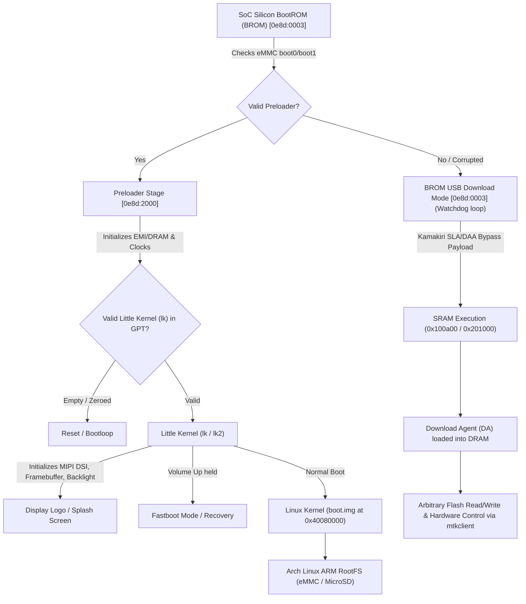

# Tecno Spark 6 (Model KE7 / KE7 JS1) — Arch Linux ARM & Bare-Metal Porting Project

A reproducible, fully documented reverse-engineering and bring-up effort to port **Arch Linux ARM / Mainline Linux** to the **Tecno Spark 6 (KE7)** from a completely wiped, bare-metal state.

---

## 1. Hardware Architecture & Specifications

| Component | Specification | Details / Identifiers |
|---|---|---|
| **Device Model** | Tecno Spark 6 | Model `KE7` (Hardware string on SIM tray: `KE7 JS1`) |
| **System-on-Chip** | MediaTek Helio G70 | `MT6769V/CB` (`k68v1` / `MT6768` platform family, HW Code `0x707`) |
| **CPU Subsystem** | Octa-Core (ARMv8.2-A 64-bit) | 2× Cortex-A75 @ 2.0 GHz + 6× Cortex-A55 @ 1.7 GHz |
| **GPU** | ARM Mali-G52 2EEMC2 | Panfrost compatible (`mediatek,mt8186-mali` / `0x13040000`) |
| **RAM (LPDDR4X)** | 4 GB | Physical base: `0x40000000` |
| **Storage (eMMC 5.1)** | 64 GB | Total sectors: `0x0747c000` (62.5 GiB / 67.1 GB) |
| **Display Panel** | 6.8" IPS LCD (720 × 1640 HD+) | MIPI DSI Video Mode (`ft8006s_hdp_dsi_vdo_hx_mdt_ke7` or `nt36525b_hdp_dsi_vdo_txd_boe_ke7`) |
| **Touch Controller** | SPI / I2C Digitizer | Novatek `nt36672a` / FocalTech |
| **PMIC** | MediaTek MT6358 | Regulates LCM power rails (VSP/VSN ±5V) and backlight boost |

---

## 2. Low-Level Boot Flow

---

## 3. Storage & Partition Layout (GPT Table)

Captured directly from the 64GB eMMC storage via BootROM Kamakiri DA:

| Partition Name | Start Offset | Length | Size | Purpose |
|---|---|---|---|---|
| `boot_para` | `0x00008000` | `0x01a00000` | 26 MB | Boot parameters |
| `proinfo` | `0x01a08000` | `0x00300000` | 3 MB | Product info, serial, hardware flags |
| `para` | `0x01d08000` | `0x00080000` | 512 KB | Parametric data |
| `expdb` | `0x01d88000` | `0x01400000` | 20 MB | Exception database / panic dumps |
| `frp` | `0x03188000` | `0x00100000` | 1 MB | Factory Reset Protection |
| `metadata` | `0x03288000` | `0x02000000` | 32 MB | Encryption metadata |
| `nvcfg` | `0x06922000` | `0x02000000` | 32 MB | NVRAM configuration |
| `nvdata` | `0x08922000` | `0x04000000` | 64 MB | NVRAM calibration & IMEI |
| `persist` | `0x0c922000` | `0x03000000` | 48 MB | Persistent device state |
| `protect1` | `0x0f922000` | `0x00800000` | 8 MB | Radio protection data |
| `protect2` | `0x10122000` | `0x00800000` | 8 MB | Radio protection data |
| `seccfg` | `0x13000000` | `0x00800000` | 8 MB | Bootloader lock/unlock security state |
| `sec1` | `0x13800000` | `0x00200000` | 2 MB | Security partition |
| `md1img` | `0x13a00000` | `0x08000000` | 128 MB | Cellular modem DSP firmware |
| `spmfw` | `0x1ba00000` | `0x00100000` | 1 MB | System Power Management firmware |
| `scp1` / `scp2` | `0x1bb00000` | `0x00600000` | 6 MB each | System Companion Processor firmware |
| `sspm_1` / `_2` | `0x1c700000` | `0x00100000` | 1 MB each | System Secure Processor firmware |
| `gz1` / `gz2` | `0x1c900000` | `0x01000000` | 16 MB each | Guest OS / Trusty isolation |
| `nvram` | `0x1e900000` | `0x04000000` | 64 MB | Baseband / RF calibration database |
| `lk` / `lk2` | `0x22900000` | `0x00200000` | 2 MB each | Little Kernel (Bootloader) primary & backup |
| `logo` | `0x22d00000` | `0x00800000` | 8 MB | Boot logo raw framebuffer bitmap |
| `boot` | `0x23500000` | `0x02000000` | 32 MB | Linux kernel (`Image.gz`) + Initramfs |
| `dtbo` | `0x25500000` | `0x00800000` | 8 MB | Device Tree Blob Overlay |
| `tee1` / `tee2` | `0x25d00000` | `0x00500000` | 5 MB each | ARM TrustZone OS / TEE |
| `vbmeta` | `0x26700000` | `0x00800000` | 8 MB | Android Verified Boot 2.0 metadata |
| `recovery` | `0x10a22000` | `0x02000000` | 32 MB | Recovery kernel & ramdisk |
| `super` | `0x28000000` | `0x138800000`| 5.25 GB | Dynamic partition container |
| `userdata` | `0x186000000`| `0xd05cf8000`| 52.1 GB | User storage area |

---

## 4. Current State & What Has Been Verified

* [x] **Host Environment Configured:** Linux udev rules installed (`/etc/udev/rules.d/52-mtk.rules`).
* [x] **Real-Time BROM Capture:** Captured hardware handshake on USB `0e8d:0003`.
* [x] **Authentication Bypass:** Kamakiri vulnerability executed, disabling SLA/DAA locks.
* [x] **Full Flash Dump Completed:** Complete non-volatile partition backup extracted to `backup/` (572 MB).
* [x] **Confirmed Zero-State:** Verified that storage wipe cleared all code in `boot`, `lk`, `recovery`, `dtbo`, and `logo`.
* [x] **Extracted Working KE7 Kernel:** Unpacked a working downstream Linux kernel 4.14.141+ targeting `k68v1` from a known KE7 recovery image.
* [x] **Identified Display Hardware:** Probed panel definitions:
  * Novatek `nt36525b_hdp_dsi_vdo_txd_boe_ke7`
  * FocalTech `ft8006s_hdp_dsi_vdo_hx_mdt_ke7`

---

## 5. Porting Roadmap: Getting the Display & Arch Linux Running

### Milestone 1: Display Bring-up
1. Flash Little Kernel (`lk.bin` / `lk2.bin`) and `logo.bin` to the device.
2. `lk` initializes PMIC MT6358 display voltage rails, toggles the LCM reset line, sends MIPI DSI initialization commands, and turns on the backlight boost.
3. Observe boot screen / color test pattern on the display.

### Milestone 2: Fastboot & Kernel Bring-up
1. Boot into Fastboot via `lk` or directly flash `boot.img` via `mtkclient`.
2. Configure kernel cmdline with `console=tty0 console=ttyMT0,921600 clk_ignore_unused pd_ignore_unused`.
3. Verify Linux kernel console on screen.

### Milestone 3: Arch Linux ARM RootFS
1. Prepare an `arm64` (aarch64) Arch Linux root filesystem on a microSD card.
2. Direct the kernel cmdline to boot root: `root=PARTUUID=... rw rootwait`.
3. Enable USB Ethernet ECM / serial ACM gadget (`1d6b:0104`) for direct terminal access over USB.
