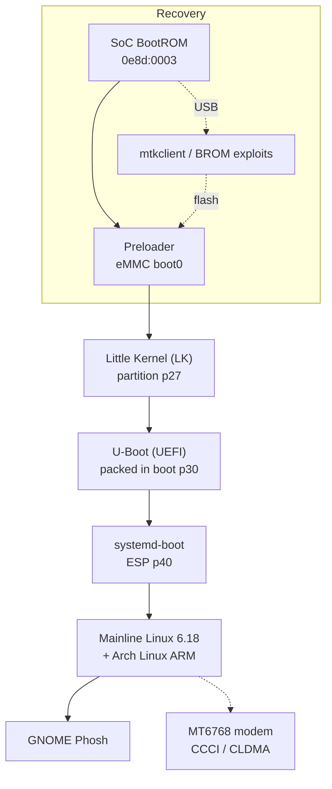

# Tecno Spark 6 (KE7) — Mainline Linux Port

> Turning a bricked 2020 budget MediaTek phone into a fully documented, pocket-sized
> Arch Linux ARM computer — and writing down every dead end along the way.


---

## Why this exists

The **Tecno Spark 6 (KE7)** is a 2020 budget phone built on the MediaTek **Helio G70
(MT6768)**. It shipped with Android 10, never received meaningful updates, and is now
end-of-life. This project documents, step by step, how to:

1. Recover one from a **completely wiped state** (all NVRAM/protect partitions zeroed,
   no IMEI, no calibration data).
2. Replace Android with **mainline Linux 6.18 + Arch Linux ARM + GNOME Phosh**.
3. Bring up the hardware one block at a time — display, touch, charging, USB
   networking, modem — using nothing but public sources, the device itself, and a
   lot of reverse engineering.

Everything here is reproducible. If you own a KE7 — or any MT6768 device — you should
be able to follow the same path, avoid our dead ends, and reuse the tooling.

**This is a work-in-progress port, not a finished product.** The status table below is
kept honest.

---

## Status

| Subsystem | State | Notes |
|---|---|---|
| Boot chain (BROM → preloader → LK → U-Boot → systemd-boot → Linux) | ✅ working | U-Boot UEFI payload packed into the `boot` partition |
| Arch Linux ARM (aarch64) + GNOME Phosh | ✅ working | pure 64-bit userspace, `systemd-boot` entries |
| Display | ✅ working (SimpleFB) | 720×1640 panel up; mainline DRM/DSI driver still on the roadmap |
| Touchscreen | ✅ working | Novatek NVT-ts SPI (`mtk-tpd`, `event3`) |
| USB gadget networking | ✅ working | `usb0` 172.16.42.2/24, SSH + HTTP proxy over USB |
| Charging during gadget mode | ✅ working | RT9471 at 1.5 A while USB data is active |
| Battery reporting | ✅ working | MT6358 + RT9471 `power_supply` link |
| GPU | ⚠️ software rendering | Panfrost works, not yet wired into the mainline DT |
| Wi-Fi / Bluetooth (MT6631 CONNSYS) | 🚧 in progress | vendor driver port underway; `wlan0` not yet stable |
| Cellular modem (MT6768 CCCI) | 🚧 in progress | driver ported to 6.18; blocked on a gated MD EINT clock (fix built, not yet flashed) |
| Audio (MT6358 + GPIO 39 amp) | ⬜ planned | amplifier GPIO already identified |
| Camera (GC02M1 / OV02B10) | ⬜ planned | both sub-sensors have mainline drivers |
| Sensors (via SCP) | ⬜ planned | chips live behind the closed SCP firmware |

Legend: ✅ works · 🚧 actively worked on · ⬜ not started

---

## The story in one diagram



Full boot-chain detail: [`docs/boot-chain.md`](docs/boot-chain.md)

---

## Hardware at a glance

| | |
|---|---|
| **SoC** | MediaTek Helio G70 — MT6769V/MT6768, 2×A75 + 6×A55, Mali-G52 MC2 |
| **RAM / storage** | 4 GB LPDDR4X / 64 GB eMMC 5.1 |
| **Display** | 6.8″ 720×1640, Novatek **NT36525B** DSI panel (BOE glass, TXD) |
| **Touch** | Novatek NVT-ts over SPI @ 13.6 MHz |
| **PMIC / charger** | MT6358 + Richtek **RT9471** (i2c 0x53) |
| **Modem** | integrated LTE (MT6768), CCCI/CLDMA link to the AP |
| **Connectivity** | MT6631 CONNSYS (Wi-Fi/BT/FM/GNSS) |
| **Audio** | MT6358 codec + external speaker amp on **GPIO 39** |
| **Sensors** | accel/light/prox/step — all behind the MTK SCP |

Full inventory with register bases, IRQs, GPIOs and I2C maps:
[`docs/hardware.md`](docs/hardware.md) ·
[`docs/reference/hardware-inventory.md`](docs/reference/hardware-inventory.md)

---

## Reverse-engineering highlights

These are the parts we are most proud of — each one was a hard wall at some point.

- **The phone arrived with every NVRAM partition erased.** `nvram`, `nvdata`, `nvcfg`,
  `persist`, `protect1/2` all read back as zero. We decoded the MediaTek NV file
  format (`NV0S_000`, LID `0xF00A`), proved the records are encrypted with a modem-side
  key derived from OTP, and restored the IMEIs through the **modem's own META API**
  rather than by patching files. → [`docs/imei-restore.md`](docs/imei-restore.md)
- **Found the real META handshake.** The preloader speaks *first*: the host sends
  `METAMETA`, the phone answers `READY` and re-enumerates as `0e8d:202d`. Every guide
  online had the direction backwards. → [`docs/tooling.md`](docs/tooling.md)
- **Bypassed a TEE licensing gate** in the vendor IMEI tool with a one-byte patch
  (`jns` → `jmp`), after proving the licence check is the only TEE consumer in the flow.
- **Ported the CCCI modem driver to mainline 6.18** and traced a bus hang to a gated
  MD EINT clock — fixed by writing `0x21` to `INFRA_AO_MD_SRCCLKENA` in U-Boot before
  the modem boots. → [`docs/modem.md`](docs/modem.md)
- **Identified the panel from a string inside LK** (`nt36525b_hdp_dsi_vdo_txd_boe_ke7`)
  and reconstructed its power/reset/bias wiring (GPIO 45, ENP 153, ENN 152).
- **Ran the whole Windows-only MTK toolchain headlessly** through a QEMU guest agent
  and synthetic input — no clicking screenshots by hand.
  → [`docs/tooling.md`](docs/tooling.md)

---

## Repository map

```
docs/                 curated documentation (start here)
  ├── overview.md     goals, constraints, results
  ├── reproduce.md    THE step-by-step guide (any device state)
  ├── firmware.md     exact build id, image manifest + SHA-256 verifier
  ├── sources.md      where to obtain firmware, tools and vendor source
  ├── hardware.md     board map, GPIO/I2C/IRQ reference
  ├── boot-chain.md   BROM → LK → U-Boot → Linux
  ├── linux-bringup.md kernel, DT, display, touch, USB, power
  ├── modem.md        CCCI/CLDMA port and the EINT fix
  ├── imei-restore.md NV format, META, TEE bypass, legality
  ├── android.md      stock ROM, root, debloat, dialer
  ├── tooling.md      mtkclient wrappers, META, VM automation
  ├── legal.md        ownership, IMEI law, firmware copyright
  └── reference/      raw research logs & inventories (deep detail)
patches/              our kernel + U-Boot changes, apply-ready
configs/              exact kernel and U-Boot .config files
dts/                  stock (decompiled), mainline and porting device trees
hardware/             partition table + dumps, with regeneration script
tools/                flashing, backup, hardware extraction, META, VM automation
cellular-port/        CCCI/CLDMA driver ported to mainline 6.18
```

### Bring your own device

Nothing here depends on our specific unit. The two scripts that make the repo
portable are:

```bash
./tools/extract-hardware.sh     # regenerate every hardware dump from YOUR phone
./tools/backup-partitions.sh    # full GPT + partition backup over BROM
```

Firmware is not hosted (copyright); [docs/firmware.md](docs/firmware.md) gives the
exact build ID, per-image SHA-256 hashes and a verifier so you can confirm your own
download is the right one.

---

## Quick start

If your phone still boots Android and you only want the Linux install:

```bash
git clone https://github.com/imaazkhalid/tecno_ke7_linux_port
cd tecno_ke7_linux_port
# read docs/reproduce.md first — it lists the prerequisites and the risks
```

If your phone is bricked, start with [`docs/reproduce.md`](docs/reproduce.md) §2
(“Recover from any state”).

> ⚠️ **Unlocking the bootloader wipes the device and voids the warranty. Flashing the
> wrong partition can brick it permanently. You are responsible for your own hardware.**
> Read [`docs/legal.md`](docs/legal.md) before you start.

---

## Documentation

Start at [`docs/index.md`](docs/index.md) for the full map, or jump straight to:

- **[Reproduce the port](docs/reproduce.md)** — from stock Android, from a brick, or from a wiped device
- **[Hardware reference](docs/hardware.md)** — everything we measured
- **[Modem deep dive](docs/modem.md)** — CCCI, CLDMA and the clock-gating bug
- **[IMEI restoration](docs/imei-restore.md)** — the NV format and the META protocol
- **[Sources and provenance](docs/sources.md)** — where to obtain firmware, tools and vendor source
- **[Raw research log](docs/reference/hardware-research.md)** — the unfiltered engineering notebook

---

## Legal & ethics

This repository contains **no proprietary firmware, no vendor binaries and no leaked
source code**. It documents methods and contains our own code, device-tree fragments
and measurements. Restoring the IMEI of a device **you own** is legitimate in many
jurisdictions, but it is regulated in some — and changing another device's IMEI is
illegal nearly everywhere. Read [`docs/legal.md`](docs/legal.md).

Tecno, MediaTek, Arm and their logos are trademarks of their respective owners. This
project is not affiliated with or endorsed by any of them.

## License

MIT — see [LICENSE](LICENSE). Reuse it, fork it, improve it.
