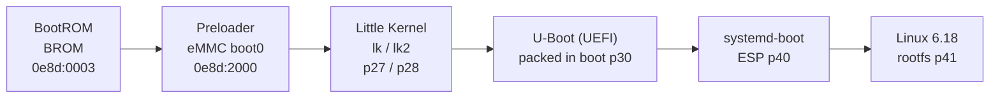

# Boot chain

The KE7 boots through five stages before Linux. Understanding which stage owns the
display, the USB port and the modem is the key to debugging a dead phone.



---

## 1. BootROM (BROM)

- Runs from on-chip SRAM before any storage is initialised.
- Exposes USB **`0e8d:0003`** ("MediaTek USB Port") — this is the last-resort recovery
  interface and it cannot be disabled.
- Verifies the preloader signature unless the device is unlocked in a way that
  bypasses it; on this SoC we used the public **kamakiri** exploit through
  `mtkclient`.
- BROM mode is entered by holding **Volume Down + Volume Up** while plugging USB on a
  powered-off phone, or by shorting the test point if the preloader is dead.

**Rule:** the BROM is the only stage that can always be recovered. If you can reach
`0e8d:0003`, the phone is never truly bricked.

## 2. Preloader

- Lives in eMMC **boot0/boot1** (not in the GPT).
- Initialises EMI/DRAM, clocks and the eMMC, then loads LK.
- Exposes USB **`0e8d:2000`** for a short window (and speaks the META handshake, see
  [tooling.md](tooling.md#3-meta-mode-the-real-handshake)).
- Holds the **download-agent (DA) flag** in a volatile register; the `da meta usb`
  command only powers the phone off on this unit.

**Rule: never flash the preloader.** A bad preloader plus a locked BROM equals a
permanent brick. We never touched it, and neither should you.

## 3. Little Kernel (LK)

- Stock bootloader in partitions `lk` (p27) and `lk2` (p28).
- Brings up the **MIPI DSI panel**, backlight, keypad, charger detection and the
  splash logo.
- Provides **fastboot** (Volume Up at boot) and the stock recovery entry.
- Contains the panel driver we mined for the NT36525B configuration — the LCM string
  `nt36525b_hdp_dsi_vdo_txd_boe_ke7` sits at file offset `0x8CDEE` in `lk.img`.

LK is also where AVB (Android Verified Boot) is enforced. Unlocking stores a flag in
`seccfg`; from then on the phone shows the **"orange state"** warning at every boot.

## 4. U-Boot (our stage)

We replace the Android kernel in the **`boot` partition (p30)** with a **U-Boot
build for MT6768** acting as UEFI firmware:

- `CONFIG_EFI_LOADER=y`, exposing a standard EFI system partition environment.
- A **SimpleFB** framebuffer handed over from LK is passed to the EFI GOP, so Linux
  gets a working console and Phosh gets a display before any DRM driver exists.
- A board hook (`board_late_init()`) writes `0x21` to
  `INFRA_AO_MD_SRCCLKENA` (`0x10001000 + 0xF0C`) so the modem's EINT controller
  clock is enabled before Linux starts it.
- Another hook copies LK's `/chosen/ccci,*` properties into the Linux DTB so the
  modem memory layout survives the bootloader handover.

The image is packed with an AVB footer and flashed to `boot`:

```bash
# build
make CROSS_COMPILE=aarch64-linux-gnu- mt6768_ke7_defconfig
make CROSS_COMPILE=aarch64-linux-gnu- -j$(nproc)
# pack as an Android boot image and write to p30 (see tools/flash_lk.sh)
```

> The exact packing/flashing helper is [`tools/flash_lk.sh`](../tools/flash_lk.sh).

## 5. systemd-boot

- Lives on the **ESP** (`p40`, vfat, `/boot/efi`).
- U-Boot's EFI loader finds `\EFI\systemd\systemd-bootaa64.efi` and boots it.
- Entries in `loader/entries/*.conf` point at the kernel and DTB on the same ESP:

```ini
title   Arch Linux ARM
linux   /vmlinuz-linux
devicetree /mt6768-tecno-ke7.dtb
options root=PARTUUID=... rw console=tty0
```

> U-Boot looks for **both** `/boot/mt6768-tecno-ke7.dtb` and `/boot/mt6768.dtb`.
> Always deploy the DTB under both names.

## 6. Linux

Mainline 6.18 with the ported CCCI driver, the KE7 device tree and Arch Linux ARM.
See [linux-bringup.md](linux-bringup.md).

---

## AVB, `seccfg` and the orange state

| Item | Meaning |
|---|---|
| `seccfg` (p?) | stores the unlock flag; written **once** by `mtkclient w seccfg` |
| `vbmeta` | AVB metadata; we flash a disabled/empty vbmeta so custom images boot |
| Orange state | the warning screen shown when the bootloader is unlocked — **expected** |
| Green state | locked; any modification fails verification |

**Never re-lock `seccfg`.** Re-locking with modified partitions is the classic
permanent brick on MTK. Leaving it unlocked ("orange state") is the safe state.

---

## Recovery entry points

| Mode | How | USB ID |
|---|---|---|
| BROM | **Vol Up + plug** on a powered-off phone (current bootloader). Before the retail flash the combo was Vol Up + Vol Down. | `0e8d:0003` |
| Preloader | plug in without keys, catch the ~2 s window | `0e8d:2000` |
| META | preloader + host sends `METAMETA` | `0e8d:202d` |
| Fastboot | Vol+ at power-on (stock LK) | `0e8d:201c`-class |
| U-Boot console | serial or EFI shell | — |
| Android adb | normal boot, USB debugging on | `0e8d:201c` |

If the phone does not enumerate at all, check the cable and port first, then the
battery (a fully drained cell can take 10+ minutes on the charger before the
preloader appears).

---

## What lives where (after the port)

```
eMMC boot0/boot1   preloader            (never touched)
p27 / p28          stock LK             (kept for fastboot/recovery)
p30                U-Boot UEFI payload
p40 (ESP, vfat)    systemd-boot + kernel + DTB
p41 (ext4)         Arch Linux ARM rootfs
p8/p9/p26          nvcfg / nvdata / nvram  (modem + calibration)
```

Full GPT: [`../hardware/gpt_table.txt`](../hardware/gpt_table.txt).
