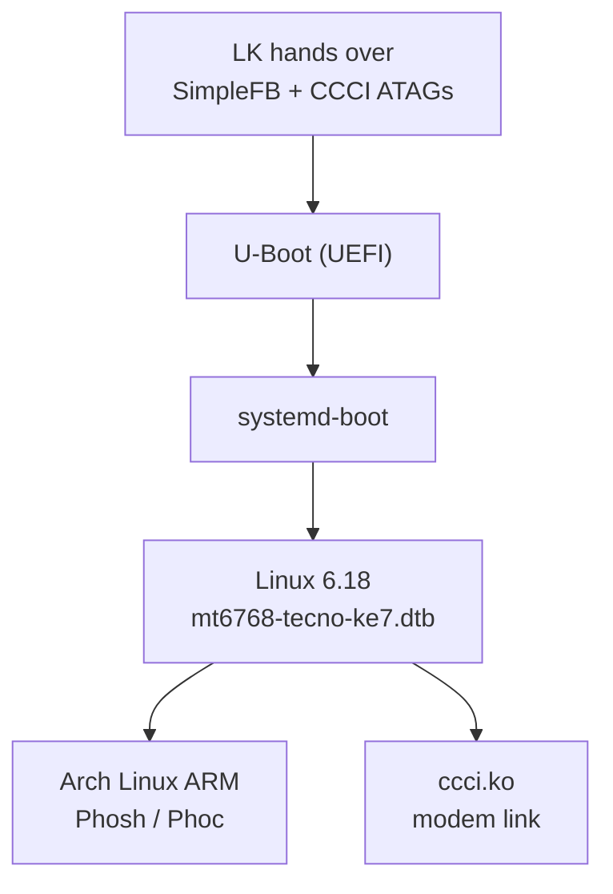

# Linux bring-up

The phone runs a **mainline Linux 6.18** kernel with a custom device tree and a pure
64-bit **Arch Linux ARM** userspace on top of GNOME Phosh.



---

## Kernel and device tree

| Item | Value |
|---|---|
| Kernel | mainline **6.18** (`6.18.0-gf612f7e0293a-dirty`) |
| Arch | arm64, `CROSS_COMPILE=aarch64-linux-gnu-` |
| Board DTS | `arch/arm64/boot/dts/mediatek/mt6768-tecno-ke7.dts` |
| Stock DT (reference) | [`../dts/ke7_mt6768.dts`](../dts/ke7_mt6768.dts), [`../dts/vendor-stock.dts`](../dts/vendor-stock.dts) |

Build and deploy:

```bash
cd linux
make -j$(nproc) ARCH=arm64 CROSS_COMPILE=aarch64-linux-gnu- \
     mediatek/mt6768-tecno-ke7.dtb

# deploy BOTH names — U-Boot tries both
scp mt6768-tecno-ke7.dtb root@172.16.42.2:/boot/mt6768-tecno-ke7.dtb
scp mt6768-tecno-ke7.dtb root@172.16.42.2:/boot/mt6768.dtb
```

Always keep `.bak` copies and record the DTB size + md5 in the project log.

---

## Display

**Current state:** the panel is driven by the **SimpleFB** framebuffer that U-Boot
inherits from LK (`720×1640×32bpp`, base `0x7E605000`). Phosh renders on it with
software compositing. This is enough for a fully usable desktop.

**What is missing for a real DRM driver:**

| Piece | Status |
|---|---|
| `mtk_drm` / `mtk_dsi` nodes | present in mainline, need board wiring |
| Panel driver (NT36525B) | **not written** — needs porch/pixel-clock timings |
| Backlight (OCP2130) | i2c driver not written; PWM fallback exists |

**Where the timings hide:** inside the stock LK. The LCM driver string
`nt36525b_hdp_dsi_vdo_txd_boe_ke7` is at `lk.img` offset `0x8CDEE`; the driver fills
an `LCM_PARAMS` struct (`HSA/HBP/HFP/VSA/VBP/VFP`, data rate, lane count). LK is
Thumb-2 at a fixed base, so the stores are easy to find once you locate the driver
table entry. Alternative: read the DSI timing registers at `0x14014000` while the
vendor kernel is running.

Known wiring (already in [`../dts/panel-nt36525b-ke7.dtsi`](../dts/panel-nt36525b-ke7.dtsi)):

- reset **GPIO 45**
- bias **ENP 153 / ENN 152**
- DSI **burst video** mode, 4 lanes, 228.5 MHz burst clock

---

## Touchscreen

Working. Novatek NVT-ts on SPI at 13.6 MHz, exposed as `/dev/input/event3`
(`mtk-tpd`). The mainline `novatek-nvt-ts` driver is i2c-only; the SPI variant uses
the same protocol with a small transport shim.

If touch stops working after a DTB change, check the SPI node, the interrupt and the
reset GPIO — the controller needs a proper reset pulse before it answers.

---

## Keys and headset

- Power/volume: `mtk-kpd` at `10010000.kp` (input `event1`).
- Headset: ACCDET (input `event0`), handles jack detect and the hook button.
- Power key is the wakeup source for suspend.

---

## USB gadget networking

The phone enumerates as a USB Ethernet gadget, giving SSH and Internet over the same
cable that charges it.

| Side | Interface | Address |
|---|---|---|
| Laptop | `enp0s20f0u3` | `172.16.42.1/24` |
| Phone | `usb0` | `172.16.42.2/24` |

```bash
ssh -F /dev/null -o StrictHostKeyChecking=no root@172.16.42.2
```

Internet is shared from the laptop through a small HTTP proxy (`tools/fast_proxy.py`,
port 8080); the phone sets `http_proxy=http://172.16.42.1:8080`.

**Gotcha:** the gadget does not re-attach by itself after a reboot. After
`systemctl reboot` the phone comes back on Wi-Fi only — over USB it looks dead until
you unplug/replug.

---

## Charging

The stock USB 2.0 limit is 500 mA; the RT9471 accepts 1.5 A.

- `/usr/local/bin/usb-charger-boost.sh` writes `1500000` to
  `/sys/class/power_supply/charger/input_current_limit`.
- A udev rule (`99-charger-fastcharge.rules`) re-applies it on every plug event.
- The fuel gauge is linked to the charger in the DTB
  (`power-supplies = <&charger>;`) so Phosh shows the charging state and bolt icon.

Result: **1.5 A charging while USB Ethernet is active** — measured and stable.

> The gauge reports a learned capacity of ~2946 mAh instead of the rated 5000 mAh
> because the battery profile was lost with the NVRAM wipe. It is a calibration
> issue, not a worn cell.

---

## Userspace (Arch Linux ARM + Phosh)

| Item | Value |
|---|---|
| Rootfs | ext4 on `p41` |
| ESP | vfat on `p40`, mounted `/boot/efi` |
| Desktop | Phosh + Phoc (Wayland) |
| Terminal | GNOME Console (`kgx`) |

**kgx spinner bug:** GNOME Console stays on an infinite spinner unless the shell
emits VTE integration sequences. Fix: source `/etc/profile.d/vte.sh` at the end of
`~/.bashrc` (after `$PS1`) and in `/etc/bash.bashrc`.

---

## GPU

Mali-G52 MC2 at `0x13040000`. Panfrost works on this GPU (verified in an earlier
install), but the mainline DT does not yet describe the GPU/OPP/DVFS setup, so the
current system runs on software rendering (`llvmpipe`). Adding the `mali` node and
the regulator/OPP links is the next graphics step.

---

## Wi-Fi / Bluetooth

MT6631 CONNSYS at `18000000` (IRQ `0x11D`). Mainline `mt76` has MT7663 support, but
the vendor firmware/EEPROM handoff on this board is non-standard. The port lives in
`wifi-port/` (not published here): CONNSYS subsystem driver, WLAN glue, and a BlueZ
HCI driver on top of `wmt_drv`/STP.

Status: **in progress**, `wlan0` not yet stable.

---

## Audio

MT6358 codec + MT6768 AFE are upstream; the missing piece is the machine driver and
the **GPIO 39 speaker amplifier** enable (`extamp_mode = 2`). Without it the
loudspeaker is silent. See [`../dts/audio-amp-gpio39.dtsi`](../dts/audio-amp-gpio39.dtsi).

---

## Modem

See [modem.md](modem.md). Short version: the driver is ported, the modem boots, and
the remaining blocker is a gated EINT clock that must be enabled in U-Boot.

---

## Operational hazards (learned the hard way)

| Hazard | Rule |
|---|---|
| `rmmod ccci` then `modprobe ccci` | **hangs the kernel**; the gadget dies instantly. Reboot instead. |
| `rmmod ccci` with ModemManager running | fails or leaves stale state; `systemctl stop ModemManager` first. |
| `systemctl reboot` over USB | phone returns on Wi-Fi only; rediscover the IP with a ping sweep. |
| U-Boot DTB name | deploy as **both** `mt6768-tecno-ke7.dtb` and `mt6768.dtb`. |
| USB gadget IP change | the host proxy and SSH config assume `172.16.42.2`; re-check after re-flash. |
